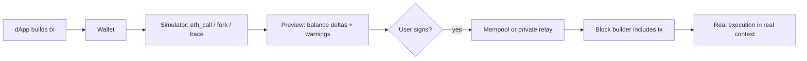

# Simulation Mechanics and Threat Model

Before a user signs an Ethereum transaction, most modern wallets show a preview: "you send 1 ETH, you receive 2,400 USDC", or "this approves unlimited spending of your WETH". That preview comes from **transaction simulation**: executing the unsigned transaction against a copy of chain state and reporting what changed. Simulation is one of the most effective anti-phishing controls in Web3, and so it has become a target. This book is about contracts that behave one way when simulated and another way when mined, and about how wallet and security teams can close that gap.

The idea is old. Malware analysts have long dealt with samples that detect a sandbox and stay quiet. Sikorski and Honig's *Practical Malware Analysis* (2012) devotes a chapter to anti-virtual-machine techniques and notes that malware which detects a VM "isn't a valuable victim" from the attacker's point of view, so it behaves benignly. A malicious contract that detects a simulator is the same trick moved on-chain. ZenGo's 2023 "Red Pill" research used exactly that framing for wallet simulators.

## How a wallet simulates a transaction

A wallet or security API typically uses one or more of the following:

| Mechanism | What it does | Typical user |
|---|---|---|
| `eth_call` | Executes a call against a block's state without creating a transaction; returns output only | Simple previews, token balance checks |
| `eth_call` with state overrides | Same, but lets the caller patch balances, code or storage first | Simulating approvals or funded accounts |
| `eth_simulateV1` | Executes a sequence of calls across one or more simulated blocks, with block and state overrides, and returns logs | Newer wallets and RPC providers |
| `debug_traceCall` / trace APIs | Re-executes with a tracer (call tree, state diff, opcode trace) | Security APIs computing asset changes |
| Forked execution | Runs a local EVM (Anvil, Hardhat, Tenderly-style forks) on top of remote state | Security vendors, researchers |

All of these share one property: the simulator has to *invent* parts of the execution context. It does not know which block will include the transaction, who will build that block, what the base fee will be, or which other transactions will run first. Mastering Ethereum (Antonopoulos and Wood, 2018) lists the context a contract can read: `tx.gasprice`, `tx.origin`, `block.coinbase`, `block.number`, `block.timestamp`, `block.gaslimit`, and so on. Every one of those values is a guess during simulation.

The output a wallet shows is usually a **balance delta**: which assets leave the user's account and which arrive. Security APIs add labels such as "known drainer", "unverified contract" or "approval to EOA".



The gap between `S` and `R` is the attack surface. It has two dimensions:

1. **Context gap.** The simulator's block, sender, gas and origin values differ from the real ones.
2. **Time gap.** Chain state changes between the moment of simulation and the moment of inclusion.

## Threat model

**Assets.** User funds and approvals; the integrity of the preview the user relies on; the reputation of the wallet or security vendor.

**Attacker.** A phishing operator who controls a malicious contract and often the dApp front end and backend. The attacker can deploy contracts, change their storage at will, watch the mempool, and send transactions with chosen gas. They cannot change the user's wallet code or forge the user's signature.

**Attacker goals.**

- Make the preview show a benign or profitable outcome while the real execution drains assets.
- Avoid being flagged by automated scanners that simulate contracts in bulk.
- Make a contract look exploitable to bots and researchers so that *they* lose funds (the honeypot case, Chapter 4).

**Defender.** Wallet engineers, security API vendors, and auditors reviewing dApps or wallet code.

**Trust boundaries.** The RPC node (is it honest and current?), the simulator's context choices, the time between preview and signature, and the path the signed transaction takes to a block.

## What is in scope

This book covers EVM chains. The same ideas apply to Solana or Move simulation, but the context variables differ. It covers detection and hardening, not building drainers. All worked examples run against local forks or local chains with Foundry. Never send test transactions that target other people's wallets or live dApps.

Related books: **ai-agent-wallet-security** covers autonomous agents that rely on simulation before signing, which makes them an attractive target for evasive contracts. **onchain-malware-analysis** covers dissecting drainer contracts once found.

## Worked example

> **Execution status:** Not executed in this book's CI; verify locally with Foundry installed. Commands are standard Foundry usage; no output is claimed.

Goal: see what context a plain `eth_call` gives a contract.

1. Start a local chain: `anvil`.
2. Write a contract that returns its view of the context:

```solidity
// SPDX-License-Identifier: MIT
pragma solidity ^0.8.24;
contract ContextProbe {
    function probe() external view returns (
        address coinbase, uint256 ts, uint256 num, uint256 basefee,
        uint256 gasPrice, uint256 gasLeft, address origin
    ) {
        return (block.coinbase, block.timestamp, block.number,
                block.basefee, tx.gasprice, gasleft(), tx.origin);
    }
}
```

3. Deploy: `forge create ContextProbe --rpc-url http://127.0.0.1:8545 --private-key <anvil key 0> --broadcast`.
4. Call it: `cast call <addr> "probe()(address,uint256,uint256,uint256,uint256,uint256,address)" --rpc-url http://127.0.0.1:8545`.
5. Call again with `--from` set to another address and compare `tx.origin`. Then send a real transaction to a non-view wrapper that emits the same values as an event, and compare the logged values with the `eth_call` values.
6. Record which fields differ between call and inclusion. On a fork of mainnet (`anvil --fork-url <your RPC>`), repeat and note how the fork chooses `block.coinbase` and `block.timestamp`.

The table you produce is the starting point for Chapter 2.

## Common pitfalls

- **Treating simulation as proof.** A preview is a prediction under assumed conditions, not a guarantee.
- **Single-context simulation.** One `eth_call` at `latest` gives an attacker one fixed environment to detect.
- **Ignoring the time gap.** A preview shown 60 seconds ago describes state that may no longer exist.
- **Trusting one RPC provider.** A stale or misbehaving node produces wrong previews for everyone using it.
- **Showing raw success/failure.** "Transaction will succeed" says nothing about where the assets go.

## Exercises

1. Run the worked example on Anvil and on a mainnet fork, and tabulate every context field that differs from a mined transaction.
2. Read the documentation of two wallet simulation providers and list which RPC methods they say they use.
3. Draw the simulation-to-inclusion pipeline for a wallet you use and mark each trust boundary.

## Further reading

- Antonopoulos and Wood, *Mastering Ethereum* (2018), chapter on Solidity global variables and security
- Sikorski and Honig, *Practical Malware Analysis* (2012), chapter on anti-virtual-machine techniques
- Ethereum JSON-RPC specification: <https://github.com/ethereum/execution-apis>
- Geth `eth` namespace documentation (including `eth_simulateV1`): <https://geth.ethereum.org/docs/interacting-with-geth/rpc/ns-eth>
- Foundry book: <https://book.getfoundry.sh/>
