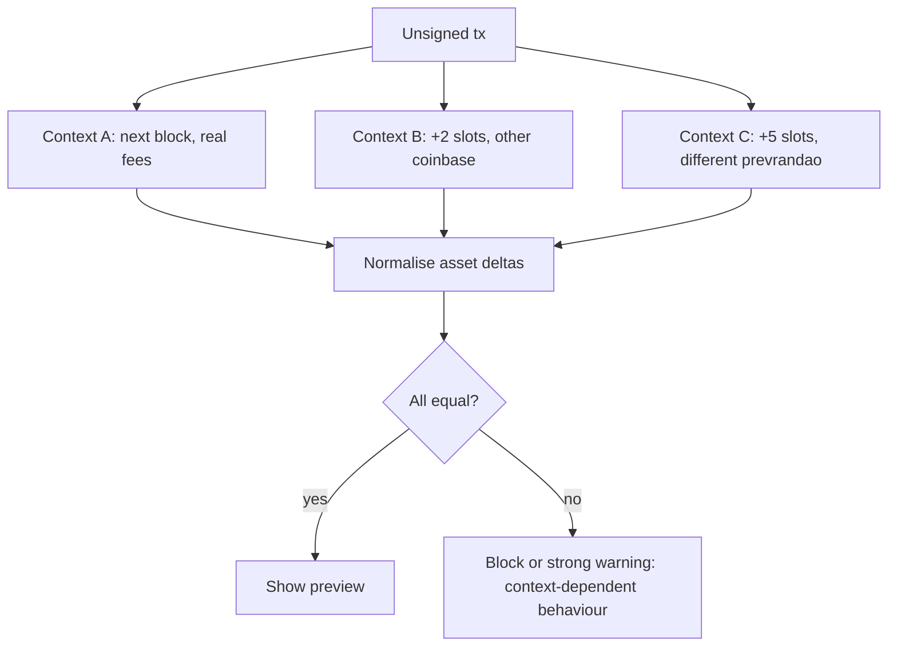

# Hardening Simulators: Multi-Context Runs, Invariants and Private Submission

The previous chapters showed three ways a preview can lie: the contract detects the simulator, state changes between preview and inclusion, or the contract is built to deceive analysis. No single control closes all three. This chapter builds a layered design that a wallet or security API can adopt incrementally.

## Layer 1: realistic, varied context

Start by removing every constant placeholder.

| Field | Weak default | Hardened choice |
|---|---|---|
| `block.coinbase` | zero address or fixed value | A recent real fee recipient, sampled from the last N blocks |
| `block.timestamp` | parent timestamp | Parent + one slot, plus runs at +2 and +5 slots |
| `block.number` | `latest` | `latest + 1`, plus a run a few blocks ahead |
| `block.basefee` | 0 | Predicted next base fee |
| `tx.gasprice` / priority fee | 0 | The fee the wallet will actually set |
| Gas limit | RPC gas cap | The gas limit the wallet will actually set |
| `prevrandao` | constant | Random value per run |
| `from` | scanner address | The real user (wallet) or fresh funded EOAs (scanner) |

`eth_simulateV1` makes this practical because it accepts **block overrides** (number, time, fee recipient, base fee, prevrandao) and **state overrides** per simulated block, and returns logs. Geth's documentation notes the total gas is capped by the node's `--rpc.gascap`, so operators running their own nodes should set it close to real block limits rather than unlimited.

## Layer 2: multi-context differential simulation

Run the same transaction under several contexts and compare the **asset deltas**, not just success. If the user's outgoing assets differ between runs, the transaction is context-sensitive, and that alone is suspicious for a typical dApp interaction.



Choose contexts so that each one varies several fields at once. An attacker who keys on a single condition (coinbase non-zero, gas price above X) will be caught if at least one run satisfies the condition and another does not. A contract that keys on a condition true in *every* plausible real block, such as "gas price greater than zero", can no longer distinguish simulation from reality once Layer 1 is in place.

Keep the number of runs small enough for latency. Three to five runs in parallel on a nearby node is a common budget; a scanner working offline can afford many more.

## Layer 3: invariants on balance deltas

A preview is only useful if it is interpreted. Define invariants that encode user intent:

- **Outflow bound.** For a "claim" or "mint" the user expects to send at most the stated price. Any outflow of other tokens or NFTs is an alert.
- **Approval scope.** New approvals must be to the contract the user is interacting with, for bounded amounts, unless the user opts in.
- **No approval to EOAs.** Approvals or `setApprovalForAll` to externally owned accounts are a strong drainer signal.
- **Recipient set.** Assets leaving the user should go to the counterparty contract, not to a fresh address.

Invariants can also be enforced *on-chain* when the dApp or wallet supports it. A guard contract or smart-account module can execute the call and then check the caller's balances, reverting if the delta exceeds a bound. This turns the preview from a prediction into a constraint. Account-abstraction wallets make this easier; see **account-abstraction-security** for module risks.

## Layer 4: freshness

From Chapter 3:

- Re-simulate immediately before producing the signature.
- Attach the simulated block number to the preview and refuse to sign a preview older than one or two slots.
- Diff the storage of the target contract between the first and last simulation; warn if it changed.

## Layer 5: submission path

Ordering attacks (an attacker transaction landing just before the victim's) are reduced by not broadcasting to the public mempool. Private relays and order-flow services send transactions directly to block builders. This helps against sandwiching and against attackers who react to the victim's pending transaction. It does **not** help against a contract owner who flips state on a timer or immediately after the dApp sees the user click "confirm", because the attacker learns of the intent off-chain. See **mev-security-engineering** for relay trust assumptions.

## Layer 6: reputation and static signals

Simulation should be combined with cheap static checks: contract age, verified source, proxy status, owner-only setters, prior reports. A contract deployed ten minutes ago, unverified, behind a proxy, with a context-sensitive branch, should not get a green preview even if every simulation agrees.

## Operational concerns

- **RPC diversity.** Run simulations against two independent nodes or providers and compare. A lagging node shows stale state.
- **Latency budget.** Users abandon slow wallets. Parallelise runs and cache static checks.
- **False positives.** Legitimate contracts do depend on time (auctions, vesting). Classify differences: a different *amount* of the same asset at +5 slots may be benign; a different *recipient* is not.
- **Monitoring.** Log context-sensitive detections and share indicators with peers; see **decentralized-threat-intelligence**.

## Worked example

> **Execution status:** Not executed in this book's CI; verify locally. Requires a node that supports `eth_simulateV1` (recent Geth or Reth on a local dev chain, or a fork tool that implements it).

Run `RedPillDemo` from Chapter 2 under three contexts with one JSON-RPC request.

```bash
cat > sim.json <<'EOF'
{"jsonrpc":"2.0","id":1,"method":"eth_simulateV1","params":[{
  "blockStateCalls":[
    {"blockOverrides":{"feeRecipient":"0x0000000000000000000000000000000000000000"},
     "calls":[{"from":"0xUSER","to":"0xDEMO","value":"0xde0b6b3a7640000","data":"0x4e71d92d"}]},
    {"blockOverrides":{"feeRecipient":"0x1111111111111111111111111111111111111111","baseFeePerGas":"0x3b9aca00"},
     "calls":[{"from":"0xUSER","to":"0xDEMO","value":"0xde0b6b3a7640000","data":"0x4e71d92d","maxFeePerGas":"0x77359400"}]}
  ],
  "validation":false,"traceTransfers":true}, "latest"]}
EOF
curl -s -H 'content-type: application/json' --data @sim.json http://127.0.0.1:8545 | jq '.result[].calls[].logs'
```

1. Replace `0xUSER` and `0xDEMO`; `0x4e71d92d` is the selector of `claim()` (check with `cast sig "claim()"`).
2. Compare the logs: the `Outcome` event should differ between the two blocks, and with `traceTransfers` enabled the ETH refund appears only in the first.
3. Wrap this in a script that normalises transfers per block and exits non-zero when they differ. That script is your differential simulator.
4. Add a third block with a later `time` override and confirm the result is stable for honest contracts.

## Common pitfalls

- **Comparing logs instead of balances.** Attackers can emit identical events while moving different assets.
- **Too few varied fields.** Varying only timestamp leaves coinbase and gas as stable detectors.
- **Treating private relays as a full fix.** They address ordering, not owner-controlled state.
- **Over-alerting on time-dependent dApps.** Classify differences by asset, amount and recipient.
- **Unbounded RPC gas caps.** They make every simulation stand out.

## Exercises

1. Build the differential simulator from the worked example and run it on five benign contracts and the three lab contracts from earlier chapters. Report detection and false-positive results.
2. Write a guard contract that executes an arbitrary call and reverts if the caller loses more than a stated amount of a given ERC-20.
3. Measure end-to-end latency of three parallel simulations against your local node and against a remote provider.

## Further reading

- Geth RPC `eth` namespace (`eth_simulateV1`): <https://geth.ethereum.org/docs/interacting-with-geth/rpc/ns-eth>
- Ethereum execution APIs repository: <https://github.com/ethereum/execution-apis>
- ScamSniffer recommendations on simulation refresh (2025): <https://drops.scamsniffer.io/transaction-simulation-spoofing-a-new-threat-in-web3>
- Flashbots Protect documentation: <https://docs.flashbots.net/flashbots-protect/overview>
- Antonopoulos and Wood, *Mastering Ethereum* (2018), security best practices chapter
